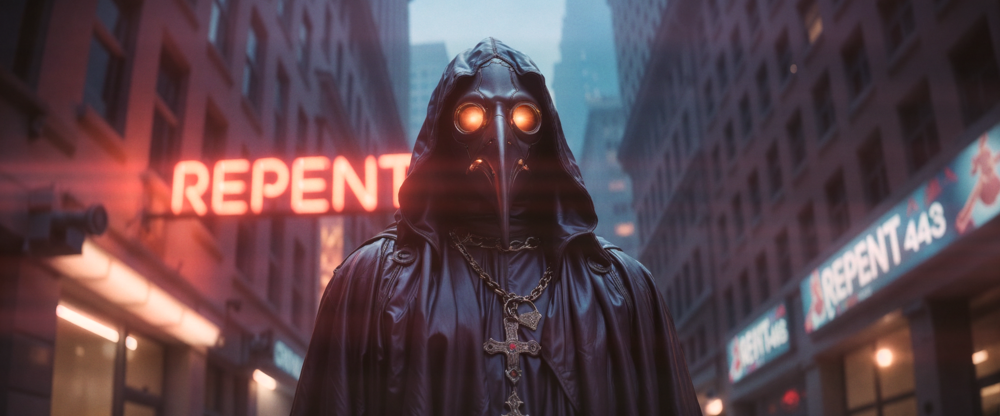
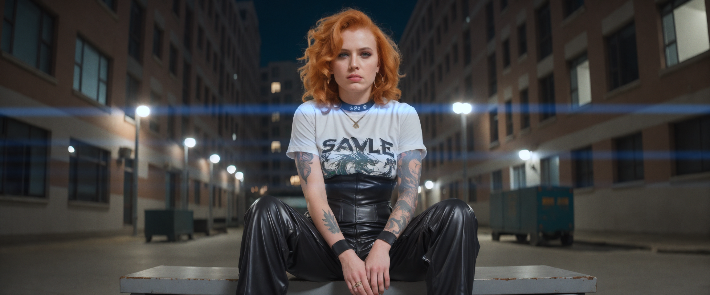
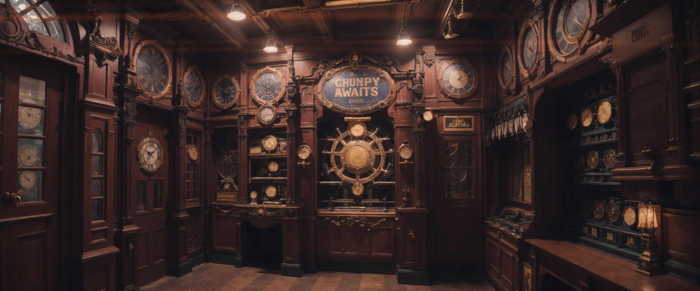

# Cinematic Effects Pack

This pack combines the anamorphic lens, curves, film grain, and color cast correction nodes.

Use this pack in place of its four source packs. Loading the old packs alongside it can register duplicate invocation IDs.

## Anamorphic lens effects

The anamorphic nodes apply lens blur, anamorphic flares, spherical distortion, chromatic aberration, and lens vignetting.
The pack also includes an aperture generator and loader. Feed either aperture output into Lens Blur for different bokeh
shapes. The loader reads image presets from `aperture_images`; add your own aperture images there.

Lens Blur requires a depth map. Its aperture image input is optional.

Suggested optical post-processing order:

Image → Lens Vignette → Lens Blur → Spherical Distortion → Chromatic Aberration → Anamorphic Streaks

Examples:

## Curves

Curves applies tone-mapping curves with Catmull–Rom, linear, cubic-spline, or shape-preserving PCHIP interpolation. It
also supports blue-noise, Floyd–Steinberg, and ordered dithering. Define input-output mappings with a comma-separated
string, for example:
`0:0,64:48,128:128,200:240,255:255`.

Extended syntax can select channels and interpolation methods, and chain multiple operations without intermediate
precision loss:

- `R(0:0,128:150,255:255)` applies the selected interpolation to red.
- `RGB[lin](0:0,128:128,255:255)` applies linear interpolation to all RGB channels.
- `L[cat](0:0,64:40,128:128,255:250)` applies a Catmull–Rom curve to OKLCH lightness.
- `R[pch](0:0,64:24,128:128,192:240,255:255)` applies shape-preserving PCHIP to red.
- `L[cat](0:0,64:40,128:128,255:250) G[cub](0:20,128:190,255:240)` chains lightness and green-channel curves.

Supported channels are RGB, R, G, B, and L (OKLCH). Supported interpolation methods are Catmull–Rom spline, linear,
cubic spline, and shape-preserving PCHIP (SciPy). PCHIP keeps monotone curves monotone without spline overshoot.
Dithering can be disabled or set to blue noise, Floyd–Steinberg, or ordered. Common image modes (RGB, RGBA, L, and LA)
are supported; alpha is preserved.

## Film grain

The film grain nodes add regular grain, monochrome grain, or chroma-only noise in OKLab space. They accept RGB and RGBA
images; alpha is preserved for RGBA inputs.

## Color cast correction

Color Cast Correction automatically adjusts an image toward a selected target color. Its strength controls the amount
of correction, and perceptual lightness is preserved.
